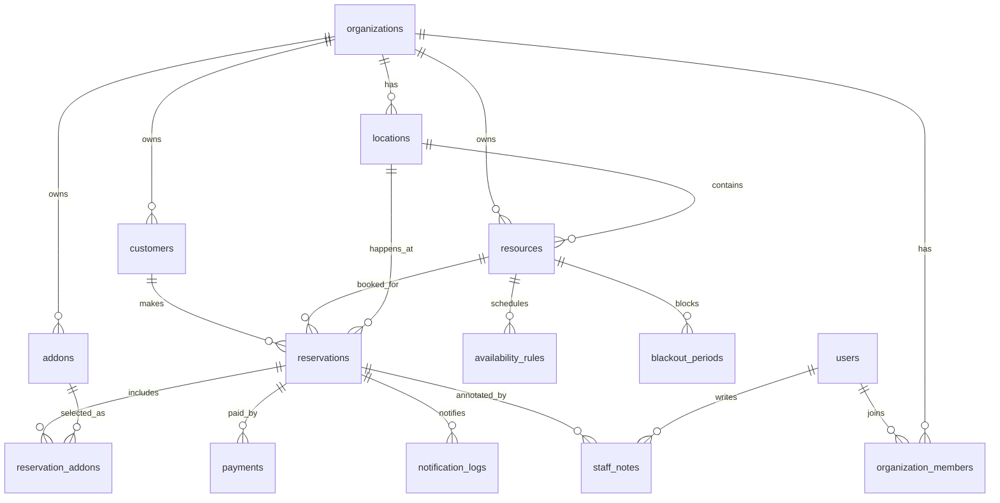

# SlotOps ERD Draft

## Design Notes

- Multi-tenant by `organization_id`
- Resources belong to locations
- Availability is rule-based, reservations are transaction-based
- Policies are explicit so they can evolve without hardcoding business rules

## Main Entities

### `organizations`

- `id` bigint PK
- `name` varchar(100)
- `slug` varchar(50) unique
- `owner_user_id` bigint
- `status` varchar(20)
- `created_at` timestamp
- `updated_at` timestamp

### `users`

- `id` bigint PK
- `email` varchar(150) unique
- `password_hash` varchar(255)
- `name` varchar(100)
- `phone` varchar(30)
- `status` varchar(20)
- `created_at` timestamp
- `updated_at` timestamp

### `organization_members`

- `id` bigint PK
- `organization_id` bigint FK
- `user_id` bigint FK
- `role` varchar(20)
- `joined_at` timestamp

### `locations`

- `id` bigint PK
- `organization_id` bigint FK
- `name` varchar(100)
- `timezone` varchar(50)
- `phone` varchar(30)
- `address_line1` varchar(200)
- `address_line2` varchar(200)
- `status` varchar(20)
- `created_at` timestamp
- `updated_at` timestamp

### `resources`

- `id` bigint PK
- `organization_id` bigint FK
- `location_id` bigint FK
- `resource_type` varchar(30)
- `name` varchar(100)
- `description` text
- `capacity` int
- `slot_unit_minutes` int
- `min_booking_minutes` int
- `max_booking_minutes` int
- `buffer_minutes` int
- `base_price` decimal(10,2)
- `currency` varchar(10)
- `status` varchar(20)
- `created_at` timestamp
- `updated_at` timestamp

### `resource_images`

- `id` bigint PK
- `resource_id` bigint FK
- `image_url` varchar(500)
- `sort_order` int

### `availability_rules`

- `id` bigint PK
- `resource_id` bigint FK
- `day_of_week` int
- `start_time` time
- `end_time` time
- `is_open` boolean
- `lead_time_minutes` int
- `same_day_cutoff_time` time null
- `created_at` timestamp
- `updated_at` timestamp

### `blackout_periods`

- `id` bigint PK
- `resource_id` bigint FK
- `start_at` timestamp
- `end_at` timestamp
- `reason` varchar(200)
- `created_at` timestamp

### `customers`

- `id` bigint PK
- `organization_id` bigint FK
- `name` varchar(100)
- `email` varchar(150)
- `phone` varchar(30)
- `memo` text
- `created_at` timestamp
- `updated_at` timestamp

### `reservations`

- `id` bigint PK
- `organization_id` bigint FK
- `location_id` bigint FK
- `resource_id` bigint FK
- `customer_id` bigint FK
- `reservation_code` varchar(40) unique
- `status` varchar(20)
- `start_at` timestamp
- `end_at` timestamp
- `guest_count` int
- `base_amount` decimal(10,2)
- `addon_amount` decimal(10,2)
- `discount_amount` decimal(10,2)
- `total_amount` decimal(10,2)
- `special_request` text
- `cancelled_at` timestamp null
- `completed_at` timestamp null
- `created_at` timestamp
- `updated_at` timestamp

### `addons`

- `id` bigint PK
- `organization_id` bigint FK
- `name` varchar(100)
- `price` decimal(10,2)
- `status` varchar(20)
- `created_at` timestamp
- `updated_at` timestamp

### `reservation_addons`

- `id` bigint PK
- `reservation_id` bigint FK
- `addon_id` bigint FK
- `quantity` int
- `unit_price` decimal(10,2)
- `line_amount` decimal(10,2)

### `payments`

- `id` bigint PK
- `reservation_id` bigint FK
- `payment_method` varchar(30)
- `payment_status` varchar(20)
- `transaction_ref` varchar(100)
- `paid_amount` decimal(10,2)
- `refunded_amount` decimal(10,2)
- `paid_at` timestamp null
- `created_at` timestamp
- `updated_at` timestamp

### `notification_logs`

- `id` bigint PK
- `reservation_id` bigint FK null
- `customer_id` bigint FK null
- `channel` varchar(20)
- `template_code` varchar(50)
- `delivery_status` varchar(20)
- `recipient` varchar(150)
- `sent_at` timestamp null
- `created_at` timestamp

### `staff_notes`

- `id` bigint PK
- `reservation_id` bigint FK
- `author_user_id` bigint FK
- `content` text
- `created_at` timestamp

## Relationship Summary

- One organization has many locations
- One location has many resources
- One resource has many availability rules
- One resource has many blackout periods
- One customer can have many reservations
- One reservation belongs to one resource and one customer
- One reservation can have many addons
- One reservation can have zero or more payment records
- One reservation can have many notification logs and staff notes

## Mermaid ER Diagram

## Initial Index Suggestions

- `locations(organization_id, status)`
- `resources(location_id, status)`
- `availability_rules(resource_id, day_of_week)`
- `blackout_periods(resource_id, start_at, end_at)`
- `reservations(resource_id, start_at, end_at)`
- `reservations(customer_id, created_at)`
- `reservations(status, start_at)`
- `payments(reservation_id, payment_status)`
